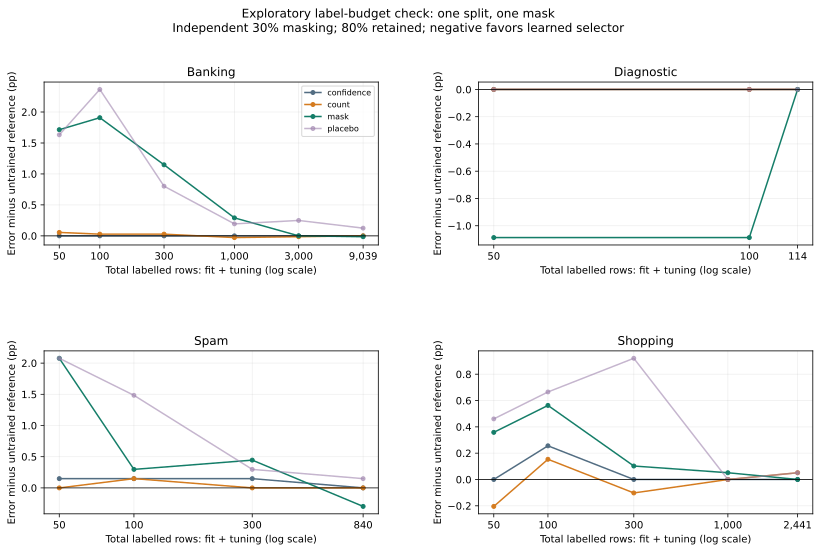

# Selective prediction under changing missingness

**Research question:** Do missingness indicators help identify classification errors beyond confidence, and does any benefit survive changed missingness patterns and honest accounting of development labels?

This portfolio release contains aggregate results from an existing exploratory study, a runnable aggregate checker, and original experiment source for inspection. It is not a publication or a new-algorithm claim. Repeated exploratory access to the datasets means these are not untouched confirmatory results.

## Result worth discussing

In the total-label-budget feasibility check, full missingness masks did not show a consistent label-efficient advantage. Under 30% independent masking and 80% retention, Banking at B=100 had about **1.908 percentage points more retained error** than the untrained confidence reference. Its largest-budget difference was only one fewer error among 7,232 retained examples. The largest Spam budget reduced errors by only two among 674. These are individual settings from one split and one corruption realization, not estimates of general superiority or statistical significance.

The study's stronger contribution to this portfolio is the evaluation discipline: removing post-exclusion duplicate feature vectors, separating tuning-label costs from apparently small fitting budgets, examining class composition, and dropping an unsupported novelty framing after closer prior-work comparison. Earlier favorable results are not the headline.



Each panel has its own vertical scale. These are sampled budgets from one split and one corruption realization, with no confidence bands; connecting lines are not population learning curves.

## Verify the published aggregates

```bash
python research/missingness/audit_aggregates.py
```

Python 3.11+, no dependencies. The script recomputes ordinary and balanced error from confusion counts for 228 rows and checks 76 label-accounting records. Its scope is limited: aggregate consistency cannot establish dataset independence, correct training, or faithful replication of prior work. Those require the original row-level caches and a fresh end-to-end run.

`results/original_audit.json` is a historical audit record from the source study. The public aggregate checker is a different, narrower check. `provenance.json` records hashes of the exact source files included in this release. `source/` contains unmodified original Python source and supporting protocols for inspection; it omits raw datasets and large intermediate prediction caches. The full original pipeline was **not rerun from a fresh environment for this portfolio release**. Do not treat this source snapshot as a verified one-command reproduction package.

## Scientific limits

- Several retained sets predict only the negative class. Ordinary error can improve through changes in retained class composition without useful positive-class decisions.
- No reliable acquisition-budget crossover, new method, universal effect, clinical validity, or real-world review utility has been established.
- Artificial masking is a stress test, not evidence about operational missingness mechanisms.
- The synthetic chronic-disease project elsewhere in the profile is a separate implementation exercise; its rule-generated labels cannot establish medical validity.
- A fresh prospective experiment needs a defensible question, closest-work review, appropriate reference methods, unseen evaluation data and uncertainty over training and label allocation.

## Data attribution and further reading

Original experiments use UCI Bank Marketing ([DOI](https://doi.org/10.24432/C5K306)), Breast Cancer Wisconsin Diagnostic ([DOI](https://doi.org/10.24432/C5DW2B)), Spambase ([DOI](https://doi.org/10.24432/C53G6X)), and Online Shoppers Purchasing Intention ([DOI](https://doi.org/10.24432/C5F88Q)). Consult the upstream datasets for their creators, licenses and descriptions before redistribution. This release includes derived aggregates, not raw records.

Geifman and El-Yaniv (2019), [SelectiveNet](https://proceedings.mlr.press/v97/geifman19a.html), is background on selective prediction. The present work is not an implementation or reproduction of SelectiveNet. See the source study's `literature_gap_assessment.md` and `corrections_log.md` for its more specific overlap and correction history.

AI assistance was extensive in the source study and in preparing this release. Scientific understanding, source verification and responsibility remain with the human author. No independent external scientific review is claimed.

## Dataset credits

Derived aggregate results use datasets credited to Moro, Rita and Cortez (Bank Marketing, 2014); Wolberg, Mangasarian, Street and Street (Wisconsin Diagnostic, 1993); Hopkins, Reeber, Forman and Suermondt (Spambase, 1999); and Sakar and Kastro (Online Shoppers, 2018), via the UCI Machine Learning Repository. The linked datasets specify CC BY 4.0: https://creativecommons.org/licenses/by/4.0/ . The reported aggregates result from preprocessing, artificial masking, model fitting and selection rather than unmodified dataset measurements. No endorsement by dataset creators is implied.
